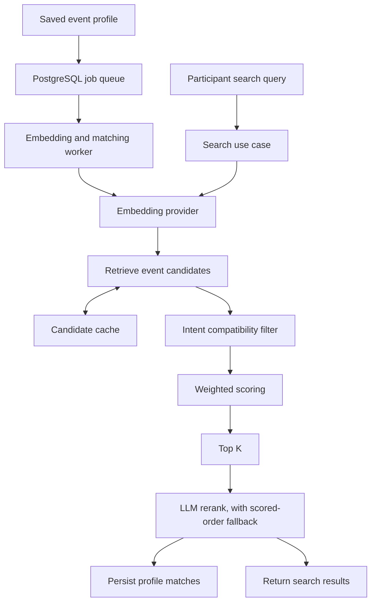

# Bridge Engine matching and search pipeline

Profile matching and on-demand search use the same pipeline. A profile update queues asynchronous embedding and matching work. A search embeds the query and returns ranked results in the request. Both paths stay event-scoped and apply the participant's intent rules.

## Stages

| Stage | Behavior |
|---|---|
| Embed | Gemini generates profile/query vectors when configured. A local BGE endpoint can be selected; deterministic profile text scoring remains available without an API key. |
| Retrieve | Fetches up to 50 candidates within the current event, using vector similarity when embeddings exist. |
| Cache | Caches retrieval candidate IDs behind the candidate-cache port. Upstash Redis is used when configured; PostgreSQL is the self-contained fallback. |
| Filter | Removes the viewer and candidates whose event intent is incompatible. |
| Score | Combines semantic similarity, intent, domain, shared interests, complementarity, and seniority signals. |
| Top K | Selects up to 12 candidates by default. |
| Rerank | Gemini may rerank the short list and provide a reason. If it is unavailable, the score order and a generated fallback reason are returned. |
| Output | Profile matching persists event-scoped match rows. Search returns its ranked list directly. |

The queue consumers are in `packages/db/workers/`; the domain stages and scorers are in `apps/web/src/domain/matching/`. The worker and web app assemble the same use cases through `apps/web/src/composition/container.ts`.
