# Bridge — End-to-End Flow

Reference for agents working on this repository. Describes the full user journey from event creation to an in-person meeting, across the three actor types: **Organizer**, **Participant**, and **System (automatic)**.

## Legend

| Color | Actor |
|---|---|
| 🔵 Blue | Organizer |
| 🟡 Yellow | Participant |
| ⚪ Gray | System (automatic) |

## Flow Diagram (Mermaid)

```mermaid
flowchart LR
    classDef organizer fill:#dbeafe,stroke:#60a5fa,color:#1e3a8a
    classDef participant fill:#fef3c7,stroke:#f59e0b,color:#78350f
    classDef system fill:#e5e7eb,stroke:#9ca3af,color:#1f2937

    A1["1 · Create event"]:::organizer
    A2["2 · Import roster (Excel)"]:::organizer
    A3["3 · Configure form · intents · zones"]:::organizer
    A4["4 · Open registration + compute matches"]:::organizer
    A5["5 · Claim login (same email / phone)"]:::participant
    A6["6 · Build profile + set intent"]:::participant

    B1["Embed profile (async worker)"]:::system
    B2["Precompute matches (pipeline)"]:::system
    B3["7 · See ranked matches + 'why you should meet'"]:::participant

    C1["Search / discover (query, anytime)"]:::participant
    C2["Retrieve (shared · cached)"]:::system
    C3["Rank (personal score)"]:::system
    C4["Instant results + mutual-interest flag"]:::participant

    D1["8 · Request intro"]:::participant
    D2["9 · Mutual accept → reveal contact"]:::participant
    D3["10 · 'Where are you?' ping → venue zone"]:::participant
    D4["11 · Meet in person"]:::participant

    A1 --> A2 --> A3 --> A4 -- "event live" --> A5 --> A6
    A6 -- "on save" --> B1 --> B2 -- "precomputed" --> B3
    A6 -- "anytime" -.-> C1 --> C2 --> C3 --> C4
    B3 -- "request intro" --> D1
    C4 -. "request intro" .-> D1
    D1 --> D2 --> D3 --> D4
```

## Step-by-Step

### Organizer setup
1. **Create event** — organizer initializes a new event.
2. **Import roster (Excel)** — bulk-import participant list.
3. **Configure form · intents · zones** — define the profile form fields, intent options, and physical/venue zones.
4. **Open registration + compute matches** — event goes live; system becomes available to participants.

### Participant onboarding
5. **Claim login** — participant claims their pre-imported roster entry via matching email/phone (gated roster claim, not open signup).
6. **Build profile + set intent** — participant confirms/completes their profile and sets their matching intent.

### Matching — two parallel paths

**Path A — Precomputed matches** (triggered `on save` of profile):
- **Embed profile** *(system, async worker)* — generates embedding for the profile.
- **Precompute matches** *(system, pipeline)* — runs the full matching pipeline in the background.
- **See ranked matches** *(participant)* — participant views ranked matches with a "why you should meet" explanation, once precomputed.

**Path B — Live search/discovery** (available `anytime` after profile is set):
- **Search / discover** *(participant)* — ad-hoc query-based search.
- **Retrieve** *(system, shared · cached)* — candidate retrieval, shared/cached across users.
- **Rank** *(system, personal score)* — personalized scoring/ranking of retrieved candidates.
- **Instant results + mutual-interest flag** *(participant)* — results returned immediately, flagged if interest is mutual.

### Connection
8. **Request intro** — participant requests an introduction, from either matches (7) or search results (4/C4).
9. **Mutual accept → reveal contact** — once both sides accept, contact info is revealed.
10. **"Where are you?" ping → venue zone** — participants ping each other's location using the configured venue zones.
11. **Meet in person** — the loop closes with an actual in-person meeting.

## Notes for Agents

- The two matching paths (precomputed vs. live search) both funnel into the same **Request intro** step — treat them as alternative entry points into the same downstream connection flow (`request-intro` → `respond-to-intro` → `reveal-contact` use-cases).
- "On save" vs. "anytime" distinguishes **eager/background computation** (async worker + pipeline, matches `workers/embed.worker.ts` and `workers/match.worker.ts`) from **on-demand computation** (retrieve + rank inline, matches `domain/matching/stages/retrieve` and `scorers/`).
- Steps 1–4 correspond to the organizer-side routes under `app/(organizer)/orgs/[orgSlug]/events/[eventSlug]/`.
- Steps 5–11 correspond to the participant-side routes under `app/(participant)/e/[eventSlug]/`.
