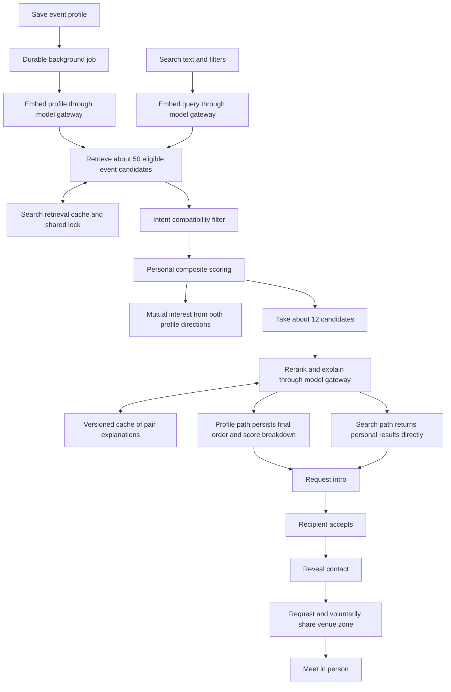

# Mr. Bridge revised production roadmap

Reviewed on 16 October 2026. The target is the documented journey from organizer event creation to participants meeting in person, using one matching pipeline with two entry points. Preserve the existing folders and the domain, application, infrastructure, and delivery boundaries.

The main flows already have implementation foundations. The largest gaps between the diagrams and the code are shared search concurrency control, a model gateway, bidirectional mutual-interest scoring, caching explanations per pair, configurable profile forms, and a complete location-request interaction. There are also correctness gaps: saved results can lose the LLM's order, embedding failures can prevent fallback, and background jobs can lose updates or remain stuck after a crash.

The signup policy remains **invited attendees claim their account**. The roster grants eligibility; authentication proves ownership of the invited email; neither a public event URL nor a successful Google login independently grants event access.

## Documentation and images used

All eight files originally present in `docs` were reviewed. The JPEG and SVG were inspected visually; the SVG was rendered to a temporary PNG for inspection.

| Source | Role in this revision |
| --- | --- |
| [PROJECT_STRUCTURE.md](PROJECT_STRUCTURE.md) | Existing directory layout, dependency direction, deployment topology, routes, and PostgreSQL cache fallback. |
| [END_TO_END_FLOW.md](END_TO_END_FLOW.md) | Organizer, participant, and system responsibilities across steps 1 through 11. |
| [END_TO_END_FLOW_TEXT_DIAGRAM.md](END_TO_END_FLOW_TEXT_DIAGRAM.md) | Confirms the background/on-demand fork and convergence at introduction requests. |
| [IMG-20260625-WA0014.jpg.jpeg](IMG-20260625-WA0014.jpg.jpeg) | Visual end-to-end journey, including account claim, two discovery paths, mutual acceptance, venue ping, and meeting. |
| [BRIDGE_ENGINE_PIPELINE.md](BRIDGE_ENGINE_PIPELINE.md) | Shared stage sequence, approximate candidate limits, provider adapters, fallback, and different output behavior. |
| [BRIDGE_ENGINE_PIPELINE_TEXT_DIAGRAM.md](BRIDGE_ENGINE_PIPELINE_TEXT_DIAGRAM.md) | Additional requirements for shared retrieval locks, scores in both directions, gateway responsibilities, and caching per pair. |
| [Bridge-Engine-Pipeline.svg](Bridge-Engine-Pipeline.svg) | Visual confirmation of those requirements, gateway calls at embedding/reranking, search filters, and the two output branches. |
| [PRODUCTION_ROADMAP.md](PRODUCTION_ROADMAP.md) | Earlier audit retained as context. Its recommendations were reconciled with the product documents and implementation rather than treated as the product specification. |

The pipeline Markdown describes the implemented baseline more narrowly than the SVG/text diagram. This roadmap retains the richer diagram requirements as work to complete. Redis is configurable, with PostgreSQL retained as the documented local fallback. A model gateway means a shared infrastructure boundary around provider calls; it does not require introducing another service or reorganizing the repository.

## Intended journey and pipeline

1. An organizer creates an event and imports its Excel roster.
2. The organizer configures profile fields, available intents, and venue zones, then opens registration and starts matching for completed profiles.
3. An invited attendee claims their roster entry through the matching phone/email identity and completes an event profile with an intent.
4. Saving the profile queues embedding and match computation in the background. The participant eventually sees ranked matches and a reason for each suggestion.
5. Independently, a participant can search after completing their profile. Retrieval is shared for the same event/query/filters, while ranking remains personal.
6. Both discovery paths feed the same introduction request and response rules.
7. A request expresses the sender's willingness to connect; the recipient's acceptance completes mutual consent and allows contact reveal. This is the working interpretation of the diagrams' “mutual accept,” consistent with the current request/response model.
8. Connected participants can ask where the other person is and voluntarily share a configured venue zone, then meet in person.

The gateway is infrastructure used at embedding and reranking, rather than an extra domain stage. Cache shared retrieval inputs and candidate IDs, not another participant's final ranking. Mutual-interest prediction and consent to reveal contacts remain separate concepts.

## What already exists

- **Organizer foundation:** event creation, Excel roster import, intent/zone configuration, open/closed status, queueing matches, and basic analytics pages.
- **Invitation eligibility and authentication:** imported roster checks, event membership checks, phone lookup, email OTP/magic links, Keycloak identity provisioning, and a distinct Google option. Public Keycloak registration is disabled.
- **Participant foundation:** event profile editing, profile-save queueing, matches, live text search, introduction requests, accept/decline, accepted-contact lookup, and voluntary zone sharing.
- **Pipeline foundation:** one `MatchingPipeline`, six weighted scorers, intent filtering, top-K, optional Gemini reranking, generated fallback reasons, and separate profile/search outputs.
- **Infrastructure foundation:** pgvector schema/index, PostgreSQL job claiming with `SKIP LOCKED`, Gemini/local BGE adapters, Upstash/PostgreSQL retrieval caches, Docker services, CI, and ECS/RDS infrastructure.

These are code-level findings. They do not establish that a complete live deployment, real Google account linking, email delivery, or every browser journey has passed acceptance testing.

## Gaps between the documented pipeline and implementation

| Requirement from the docs or images | Current implementation and consequence | Required change |
| --- | --- | --- |
| Organizer configures the profile form | `form_config` exists in the schema and repository interfaces. The organizer screen edits intents/zones, while the participant form is fixed. | Add configuration and rendering for a supported field catalog, with matching server validation. |
| Search accepts text and filters | `SearchForm.tsx` and the search use case accept text only. With no embedding, candidate retrieval is alphabetic rather than query-based. | Add defined filters and query-sensitive lexical fallback. Share retrieval only across equivalent inputs. |
| Shared retrieval with a single-flight lock | `RetrieveStage` performs get/retrieve/set. `CandidateCache` has only get/set; concurrent cache misses can repeat work. Query embedding occurs before this cache lookup. | Add distributed request coalescing and separately cache/coalesce query embedding when appropriate. Version retrieval keys and handle cache outages. |
| Model gateway handles swapping, fallback, and cost | `ProviderRegistry` selects adapters. `CircuitBreaker` and `Bulkhead` are empty classes; provider calls have timeouts but no shared budget/concurrency/fallback policy. | Implement the infrastructure policy around both embed and rerank calls, using existing ports. |
| Mutual-interest flag compares both personal scores | `ScoreStage` sets `mutualInterest` using `areIntentsMutuallyCompatible`. It does not compare score(A→B) and score(B→A). | Compute both profile directions and apply a configurable threshold. Intent alignment alone must not be reported as the diagram's mutual-interest prediction. |
| Rerank only the short list and cache per pair | Top-K before rerank exists. `GeminiLlmProvider` reranks the shortlist as a batch, but there is no pair explanation cache. | Add versioned, directional pair explanation caching without reusing a whole ranking across viewers or unrelated queries. |
| Final precomputed results preserve rerank | `PostgresMatchRepository.save` stores candidates without an explicit rank. Reads order by the original numeric score, which can undo LLM order. | Persist final rank and computation version; read that order with deterministic ties. Keep the original score and its breakdown. |
| “Instant” personalized search | Search awaits embedding and optional reranking inline, with individual provider timeouts of 15 and 20 seconds. There is no complete request latency budget. | Agree a search latency target, apply a total deadline, and return scored fallback results when optional rerank exceeds it. |
| Fallback without working model APIs | No API key returns null embeddings; rerank failures have scored fallback. Embedding exceptions propagate, and null embeddings can cause another embed call in the match phase. | Define bounded fallback/retry behavior for embedding outages and missing credentials; keep text/query relevance usable. |
| Profile save reliably updates matches | Save and enqueue are separate writes. Active jobs suppress another enqueue, jobs have no profile revision, and running jobs have no lease expiry. | Commit profile change plus durable work atomically, process revisions, reclaim crashed jobs, and prevent stale writes from replacing newer results. |
| Current eligible candidates only | Retrieval checks event and visibility, but not completed profiles. Saved match reads do not filter `p.visible`. Other participants' saved results are not automatically refreshed on a changed profile. | Apply eligibility on reads and writes, invalidate affected caches/results, and define when to recompute other participants. |
| “Where are you?” ping and response | `shareVenueZone` updates the sender's event-level zone. The page offers “Ping zone,” but there is no location-request notification or reply state. | Add a request/notification/reply interaction. Decide whether voluntary sharing applies to one connection or all accepted connections; label it clearly. |
| One pipeline and event isolation | The event routes use the shared pipeline, but the reachable legacy `/api/match` reads global roster candidates and uses a separate Gemini flow/cache. | Disable that legacy behavior or adapt its route to the event-scoped application use case. Keep the existing file layout. |

## Work ordered from easy to hard

Estimates are focused coding effort for one developer familiar with this stack. One day means roughly six productive hours. Ranges overlap; order is approximate. Credential provisioning, DNS, external approval, infrastructure waiting, and stakeholder testing are excluded. Each item includes its focused verification; the later test item covers system-wide acceptance and CI integration.

**P0** means a correctness, security, or reliability release blocker. **P1** means functionality required to complete the documented experience. Both groups belong in the full production scope. Effort order is not execution order; dependencies are listed in the next section.

| ID | Priority | Work | Effort | Done when |
| --- | --- | --- | --- | --- |
| R01 | P0 | Make local setup reproducible: consistent Node runtime, portable Windows npm commands, explicit environment loading, Turbo environment propagation, and startup validation. | 2–4 hours | A fresh checkout starts the documented stack and reports missing settings clearly. |
| R02 | P0 | Activate real email and Google credentials; verify app/broker callback URLs; keep development OTP logging disabled in production. | 2–4 hours | Invited test identities complete both flows with real services and secrets stay server-side. |
| R03 | P0 | Fix expired/tampered-cookie handling, event return destinations, and failure recovery. Middleware currently redirects on cookie presence. | 3–6 hours | Expired sessions can sign in again without loops; successful and cancelled attempts retain the intended event. |
| R04 | P0 | Persist and read final rerank order, with deterministic ordering and a computation version. | 4–8 hours | A deliberately reranked list keeps the same order after persistence and page reload; scores remain explainable. |
| R05 | P0 | Enforce complete/visible/event-member eligibility in retrieval, cached candidate hydration, and saved-match reads. | 4–8 hours | Hidden, incomplete, removed, and other-event profiles do not appear through any results path. |
| R06 | P1 | Finish accessible UI states and shared validation: labels, keyboard use, mobile layout, reduced motion, pending/error/empty states, input bounds, and upload limits. | 1–2 days | Normal and failing organizer/participant submissions provide usable feedback without losing entered data. |
| R07 | P0 | Remove the legacy global matching behavior while retaining the route file or routing through the shared event-scoped use case. | 1–2 days | Every reachable matching endpoint checks event access and uses the same retrieval/scoring rules. |
| R08 | P0 | Define event lifecycle permissions and expose real queue status. Cover profile saves, search, refresh, intros, and venue sharing; distinguish no candidates from failed/stuck computation. | 1–2 days | Draft/open/closed events behave consistently and users can tell pending, failed, empty, and ready results apart. |
| R09 | P0 | Harden OTP/lookup abuse controls, atomic issue/attempt limits, trusted IP handling, session mutation origin checks, and expired token cleanup. | 1–2 days | Concurrent attempts cannot bypass limits; roster enumeration and disallowed-origin mutations are controlled. |
| R10 | P0 | Correct deployment gates and pin web, worker, migration, and optional Keycloak tasks to the intended release images. | 1–2 days | Required checks gate release; the new migrator actually runs; smoke tests and rollback identify the deployed version. |
| R11 | P0 | Require production HTTPS, validate database certificates, restrict Keycloak administration, and separate runtime/migration/identity database permissions and secrets. | 1–2 days | Production cannot silently run with insecure transport or excessive shared credentials. |
| R12 | P1 | Finish invited account lifecycle: delivery/resend, claim timestamp, explicit revocation, profile-completion status, and wrong-invitation recovery. | 1–3 days | Repeated claims reuse the right identity; revoked membership fails; organizers see accurate invitation and completion states. |
| R13 | P0 | Complete Google/OTP identity linking, session revocation, and consistent logout. Match required Keycloak screens to the site and use the supported shared app-domain routing. | 2–3 days | OTP→Google and Google→OTP keep one identity without password dead ends; removed/disabled users lose app access. Google authentication itself still uses Google. |
| R14 | P0 | Harden organizer roles and roster import ownership/atomicity. Imports currently update global identity fields and attach event rows separately. | 2–3 days | Only authorized roles mutate their events; imports validate before applying, retry safely, and cannot silently replace another organization's identity/contact data. |
| R15 | P1 | Implement organizer-configurable profile fields using `form_config`, a supported field catalog, and shared validation rules. | 2–3 days | Organizer configuration controls participant rendering and server acceptance; existing profile fields still feed matching consistently. |
| R16 | P1 | Complete query-aware search and filters. Keep query relevance distinct from personal profile compatibility; add lexical retrieval when embeddings are unavailable. | 2–3 days | Different queries produce meaningfully different eligible results; filters apply to cache hits and misses; ranking is still personal. |
| R17 | P1 | Implement bidirectional mutual-interest scoring with calibrated thresholds and versioned weights. | 2–3 days | Both profile-direction scores must meet the defined rule; a high one-way score or compatible intent alone does not produce the flag. |
| R18 | P1 | Cache pair explanations with viewer/candidate direction, profile versions, model/prompt/scorer versions, and search context where relevant. | 2–3 days | Unchanged pairs reuse suitable explanations; profile/query changes invalidate them; batch order is never reused as another viewer's ranking. |
| R19 | P0 | Add profile visibility and connection abuse controls, contact/zone access tests, retention/deletion handling, and security audit records. | 2–3 days | Private contacts stay gated by consent; hidden/revoked users follow the defined policy; sensitive data does not remain indefinitely in caches or exports. |
| R20 | P1 | Add distributed search retrieval locking, query-embedding reuse, complete cache keys, corpus versioning/invalidation, and bounded cache-failure fallback. | 2–4 days | Concurrent identical requests across replicas coalesce; unrelated events/filters/models remain separate; every viewer is reranked personally. |
| R21 | P0 | Make profile-to-embedding-to-matching work durable and revision-aware; add leases, recovery, bounded retries, terminal failure inspection, and affected-participant refresh. | 2–4 days | Worker crashes and rapid profile edits cannot lose the latest update or publish stale results; new/changed eligible participants reach affected match lists. |
| R22 | P1 | Implement the model gateway policies around existing provider ports: time budgets, transient retries, circuit breaking, concurrency limits, provider fallback, usage/cost accounting, and versioned embeddings. | 2–4 days | Both embed and rerank calls obey the same limits; provider outages return the defined fallback; unrelated embedding spaces are not mixed. |
| R23 | P1 | Complete reliable intro notifications and the location-request/reply interaction through an outbox, retries, deep links, deduplication, consent, expiry, and request throttling. | 2–4 days | A location request reaches the intended accepted connection; they can voluntarily reply; stale zones expire and notification failures do not lose the interaction. |
| R24 | P0 | Add complete pipeline, persistence, real-database/Keycloak, browser, tenant-isolation, and failure/concurrency coverage in CI. | 3–5 days | The journey and acceptance cases below pass using production-like dependencies; critical suites cannot silently skip. |
| R25 | P0 | Complete staging, measured search/job latency and cost budgets, capacity checks, actionable monitoring, backup restore, release rollback, secret rotation, and launch runbooks. | 3–5 days | Operators can observe and recover the whole journey, and the chosen attendee/concurrency target meets agreed service targets. |

These estimates are not a fixed delivery promise. Do not add them as independent tasks without accounting for shared validation, migrations, UI work, and tests. Establish a delivery estimate after the first runnable milestone and the scoring/cache contracts below are agreed.

## Execution sequence from beginning to production

### Milestone 1 Establish a working baseline

Complete R01–R03 and start the security corrections R07, R09, and R11 early. Bring up PostgreSQL/pgvector, Keycloak, migrations, web, and worker. Create two events and invited test identities. Verify that the existing code-login and Google paths return to the intended event.

**Exit:** another developer can reproduce the stack; an uninvited or other-event identity is denied; login works against real dependencies. Record current search latency and provider call counts before optimizing them.

### Milestone 2 Finish organizer setup and invited onboarding

Complete R06, R08, and R12–R15. Establish organization ownership/roles, import safely, configure fields/intents/zones, open the event, claim an account, and save a complete profile. R15 depends on shared validation in R06 and event lifecycle rules in R08; R12 depends on real email from R02.

**Exit:** the organizer and participant can complete documented steps 1–6 through the website, with consistent branding and recoverable errors. Public registration remains disabled.

### Milestone 3 Make background matching correct

Complete R04, R05, R17, R19, and R21. Implement durable versioned saves/jobs, eligibility, both score directions, persisted final order, and result freshness. Begin R22 so an embedding outage cannot strand the journey. Add the relevant R24 regression tests during these changes.

**Exit:** profile save produces current event-scoped matches with reasons and score breakdown; reloading preserves rank; rapid edits and worker restarts recover safely. A change to candidate B has a defined refresh effect on A's stored suggestions.

### Milestone 4 Complete shared search and model infrastructure

Complete R16, R18, R20, and R22. Define query/filter semantics before finalizing cache keys. Reuse the profile/scoring versions established in milestone 3. Implement query embedding/retrieval coalescing, personal scoring, explanation reuse, and request latency limits.

**Exit:** the same query can share candidate retrieval across users while returning personalized order and reasons. Repeated/concurrent searches avoid duplicate expensive work, provider failures have useful fallback, and all results respect event/visibility filters.

### Milestone 5 Finish introductions and venue meeting coordination

Complete R23 against the access and privacy rules in R05, R08, and R19. Both matches and search call the same introduction use cases. Finish accept/decline, reliable notifications, private contact reveal, location requests, voluntary replies, and expiry.

**Exit:** A can discover B, request an intro, obtain B's acceptance, exchange private contact details, ask their venue zone, and meet. A third attendee cannot read or mutate this exchange.

### Milestone 6 Qualify and release production

Complete R10–R11 and finish R24–R25. Run the full journey in isolated staging, including both discovery paths and failure drills. Gate release on the same tested images and compatible migrations. Promote only after the agreed latency, privacy, reliability, and recovery conditions pass.

**Exit:** deployment is repeatable, observability covers the whole pipeline, rollback/restore have been exercised, and a live smoke test proves the product journey rather than only the health endpoint.

## Contracts to settle before their implementation

These decisions clarify the diagrams without changing their central architecture. Resolve them when starting the dependent milestone; unrelated work can proceed.

| Contract | Proposed starting point | Affected work |
| --- | --- | --- |
| Mutual-interest prediction | Compute score(A→B) and score(B→A) from their event profiles with the same versioned scorer configuration; calibrate the threshold on examples. Keep query relevance and actual intro consent separate. | R17, R24 |
| Search meaning and filters | Combine query relevance with personal compatibility. Begin with supported event intent/domain filters; validate the catalog rather than adding arbitrary filters. Agree relevance and latency examples before tuning weights. | R16, R20, R22 |
| Pair explanation reuse | Key by event, viewer and candidate direction, both profile revisions, and model/prompt/scorer versions. Include query context for query-specific explanations. A pair cache does not determine the order of the full shortlist. | R18, R20 |
| Shared retrieval | Keys include event, normalized query, normalized filters, embedding/retrieval configuration, and corpus revision. Revalidate eligibility after cache lookup; coalesce across replicas with expiring locks and safe ownership. | R05, R16, R20 |
| Model fallback | Keep bounded provider retries separate from job retries. Return lexical/scored results on permitted model failures and retain generated reasons when rerank is skipped. Do not assume Gemini and local BGE vectors share one space. | R16, R21, R22 |
| Location sharing | Model a request and a voluntary reply, not GPS tracking. Existing storage is per attendee/event, so all accepted contacts may see a current shared zone. Define and display that audience, or add connection-scoped storage. Preserve the existing 15-minute expiry unless changed deliberately. | R19, R23 |
| Configurable forms | Support labels, required/optional fields, and visibility for known matching fields first. Version form configuration so changing it does not corrupt existing profiles or embeddings. | R15, R21 |
| Intro consent | Sender request plus recipient acceptance counts as both parties consenting. Do not require two separate accept buttons unless the product rule changes. Keep model-predicted mutual interest separate from permission to reveal contacts. | R19, R23, R24 |

## Where implementation belongs

| Existing location | Changes that belong there |
| --- | --- |
| `apps/web/app` | Organizer/participant UI, auth routes, action input handling, pending/error states, and delivery access checks. |
| `apps/web/src/domain` | Intent specifications, scoring and mutual-interest rules, top-K behavior, profile validation rules, and introduction consent rules. |
| `apps/web/src/application` | Use-case orchestration and ports for cache coordination, model policy, notification delivery, invitation/zone interactions, and persistence contracts. |
| `apps/web/src/infrastructure` | PostgreSQL/cache adapters, provider gateway policy, circuit breaker/bulkhead behavior, notification adapters, and metrics integration. |
| `apps/web/src/composition` | Construct and inject those adapters; use cases should not select vendors themselves. |
| `packages/db` | Versioned migrations, rank/revision columns, durable jobs/outbox records, leases, claims, and repository implementations. |
| `packages/auth`, `packages/email`, `keycloak` | Identity linking/session rules, invitation/login email delivery, and realm/branding configuration. |
| `infra`, `.github`, `docker-compose.yml`, `tools` | Runtime configuration, secure deployment, release gates, bootstrap commands, observability, and recovery tooling. |
| `tests` | Deterministic scoring tests, repository integration, auth/tenant checks, concurrency tests, and browser acceptance. |

Extend files and add supporting files inside these existing directories. Keep database/vendor operations behind application ports, and retain one domain pipeline for profile matching and search.

## Production acceptance checks

| Journey or failure case | Required result |
| --- | --- |
| Organizer setup | Owner creates an event, imports a roster, configures supported fields/intents/zones, opens registration, and queues only eligible completed profiles. |
| Invited claim | Invited attendees authenticate by code or Google and reach their event; uninvited, revoked, and other-event identities fail. Phone lookup still proves email ownership rather than treating a known number as authentication. |
| Account reuse | OTP then Google, Google then OTP, logout, expired cookie, cancelled consent, and identity disablement behave without duplicate accounts or login loops. |
| Profile save and background matching | The latest saved revision is eventually embedded and matched. Kill the worker between stages and verify recovery without lost work or stale replacement. |
| Rank persistence | Feed a shortlist where LLM order differs from numeric-score order. The same final order survives database write/read and browser reload. |
| Mutual-interest meaning | Compatible intents with low scores do not automatically produce the flag. Test one high direction, both high directions, missing embeddings, and changed scorer configuration. |
| Search and filters | Two different queries change relevance; filters constrain results; no-key/provider-outage fallback remains query-sensitive. Complete the agreed profile before search. |
| Shared cache without shared ranking | Concurrent equivalent queries across web replicas coalesce embedding/retrieval work. Different viewers still receive personal scores/order; event/query/filter/version changes select different cache entries. |
| Explanation reuse | An unchanged directional pair reuses an appropriate explanation; changed profiles or query context cannot reuse stale reasoning. Optional rerank failure returns generated fallback reasons. |
| Visibility and isolation | Hidden/incomplete/removed profiles disappear from fresh, cached, and stored results. Direct legacy API calls cannot access global candidates. |
| Intro and consent | Both discovery paths create the same request type. Only the intended recipient can accept/decline; contacts appear only after consent. Test self-requests, duplicates, replay, and unauthorized reads. |
| Venue coordination | A request notifies an accepted connection; replying is voluntary; invalid zones, unrelated attendees, and expired zones are handled. Sharing audience is explicit. |
| Event closure and revocation | Every action follows the chosen closed-event policy. Removing access prevents further reads/mutations through existing sessions and cached data. |
| Notifications and provider outage | Email/model/cache failures are bounded and observable. Durable notification events can retry without duplicate visible interactions; provider calls obey budget and latency rules. |
| Production deployment and recovery | Required CI suites pass, intended migration/image versions deploy, smoke checks cover real flows, and rollback plus restored-database rehearsal succeed. |

## Changes from the earlier roadmap

This revision makes configurable forms, query filters, distributed single-flight retrieval, pair explanation caching, the model gateway, and venue request/reply explicit requirements from the docs and images. It also adds targeted work for bidirectional scoring, preserving persisted rerank order, query-aware fallback, and versioned background recomputation. The earlier authentication, event-isolation, transport, deployment, and operational findings remain relevant, but now sit within the documented product sequence.

This file is a documentation and implementation-gap review. No runtime behavior was changed or newly exercised for this revision. Live provider, browser, container, and deployment acceptance remain part of the execution plan above.
